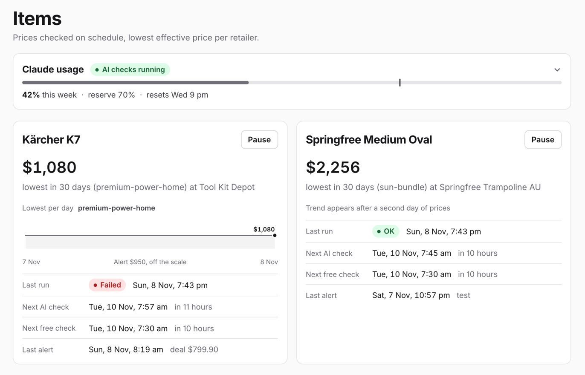
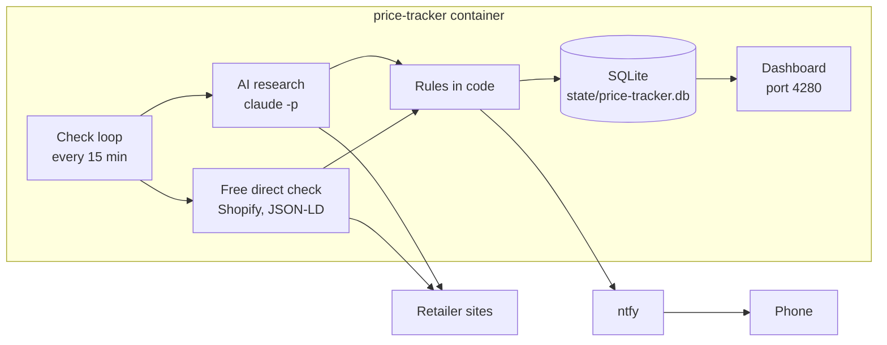

<h1 align="center">price-tracker</h1>

<p align="center">
  <strong>Tell it what you want to buy. Get notified when the price is right.</strong><br/>
  Describe the product in plain words. It searches sites on a schedule, checks your rules in plain code, and pings your phone when a listing meets them.
</p>

<p align="center">
  
  
  
  
  
</p>

<p align="center">
  <a href="https://furey.github.io/price-tracker/"><strong>Read the documentation →</strong></a>
</p>

## Contents

- [Overview](#overview)
- [Features](#features)
- [Prerequisites](#prerequisites)
- [Quick start](#quick-start)
- [Configuration](#configuration)
- [Regions](#regions)
- [Security](#security)
- [Documentation](#documentation)
- [Troubleshooting](#troubleshooting)
- [Disclaimer](#disclaimer)
- [Contributing](#contributing)
- [Support](#support)
- [Licence](#licence)

## Overview

`price-tracker` is a self-hosted price tracker. You describe a product, and the app drafts an item. An item lists the models you accept in order of preference, a price cap for each, and the sites to check. On a schedule, Claude Code (`claude -p`, with only the `WebSearch` and `WebFetch` tools) searches sites and reports each listing as JSON. Node code then applies your rules and sends an [ntfy](https://ntfy.sh) alert when a listing qualifies. The model never decides whether to alert.

<p align="center">
  
  <br/><em>The item list</em>
</p>



One container runs the dashboard and the check loop. A research run takes about `7–10 minutes`, so the app suits purchases you plan over weeks. It is too slow for flash sales.

## Features

- **Items with price rules**: each item lists accepted models in order, a price cap per model, look-alikes to reject, and the sites to check. Every edit saves a new version.
- **New item wizard**: describe what you want in plain words; Claude asks a few questions, researches models and prices, and drafts the item for you to review.
- **Free direct checks**: known product pages get a plain fetch on their own schedule. Shopify and JSON-LD pages give a price with no AI.
- **Real prices**: kits (a body and a battery from different shops), members-only prices, marketplace rules, and delivery to your postcode.
- **Alerts through ntfy**: one deal alert per run, with a link to the evidence on the dashboard. A repeat alert for the same retailer and model needs a lower price.
- **Tuning from evidence**: mute a model, a site, or one product. The app suggests changes from recent results, and you accept or dismiss each one.
- **Limits on AI use**: a monthly cap on research runs (`150` by default) and reserves on your Claude weekly (`70%`) and five-hour (`90%`) usage. Free checks keep running when AI checks pause.
- **Bot checks**: the app never solves a CAPTCHA or bot check. It marks the site **Bot check** on the dashboard, so you can check that price in your own browser.

## Prerequisites

- A Claude subscription, and [Claude Code](https://code.claude.com/docs/en/overview) on a computer with a browser, to make a login token with `claude setup-token`.
- The [ntfy app](https://ntfy.sh) on your phone.
- A Linux host (NAS, mini PC, or server) or a Mac with Docker and Docker Compose v2. The image runs on `amd64` and `arm64`.

## Quick start

- [1. Install](#1-install)
- [2. Sign in](#2-sign-in)
- [3. Subscribe to alerts](#3-subscribe-to-alerts)
- [4. Make an item](#4-make-an-item)

### 1. Install

Run the installer on the host:

```sh
curl -fsSL https://raw.githubusercontent.com/furey/price-tracker/main/install.sh | sh
```

The installer makes a `price-tracker` folder and downloads `docker-compose.yml` and `.env`. It asks for a dashboard password, the dashboard address, the region, and optional Claude and ntfy tokens. It generates `SESSION_SECRET`, then starts the container. Read [`install.sh`](install.sh) before you pipe it to a shell.

To install by hand, copy [`docker-compose.example.yml`](docker-compose.example.yml) to `docker-compose.yml` and [`.env.example`](.env.example) to `.env`, fill in `.env`, then run:

```sh
mkdir -p state logs
docker compose up -d
```

### 2. Sign in

Open the dashboard address, for example `http://<host-ip>:4280`, and sign in with your password. If you skipped the Claude token, paste it under **Settings**, then press **Test Claude login**.

### 3. Subscribe to alerts

The image ships example items with placeholder topics. Give every item and the app a random topic:

```sh
docker exec price-tracker node src/cli.js rotate-topics
```

Then open **Settings → Phone alerts**, copy each topic, and subscribe to it in the ntfy app. **Send test** confirms delivery.

### 4. Make an item

Press **New item**, describe what you want to buy, answer the questions, and check the draft before you save it. See [Creating an item](https://furey.github.io/price-tracker/guide/new-item).

To update later, run `docker compose pull && docker compose up -d` in the install folder. To run on a Mac without Docker, see [Getting started](https://furey.github.io/price-tracker/guide/getting-started#run-on-a-mac).

## Configuration

`.env` holds the configuration. [`.env.example`](.env.example) lists every variable with comments. Values marked "also a setting" there can change later on the Settings page; a value saved on the page wins over `.env`.

| Var                       | Notes                                                                               |
| ------------------------- | ----------------------------------------------------------------------------------- |
| `APP_PASSWORD`            | dashboard password; required in Docker unless `ALLOW_NO_AUTH=1`                     |
| `SESSION_SECRET`          | signs the login cookie; at least `32` characters (`openssl rand -hex 32`)           |
| `ALLOWED_HOSTS`           | `Host` values with port that may use the API, for example `nas.local:4280`          |
| `DASHBOARD_URL`           | the address that alert links open                                                   |
| `CLAUDE_CODE_OAUTH_TOKEN` | token from `claude setup-token`; also a setting                                     |
| `REGION`                  | `au` (default), `us`, or `generic`; see [Regions](#regions)                         |
| `DELIVERY_POSTCODE`       | optional; research records delivery costs to this postcode or ZIP code              |
| `NTFY_ACCESS_TOKEN`       | optional ntfy token; sent only to `NTFY_TRUSTED_SERVER` (default `https://ntfy.sh`) |
| `TRUST_PROXY`             | set to `1` only behind a reverse proxy you control                                  |
| `PUID`, `PGID`            | the user and group that own `./state` and `./logs` (default `1000`)                 |

The full list, with defaults and validation rules, is in [Configuration](https://furey.github.io/price-tracker/reference/configuration).

## Regions

One install shops in one region and one currency. `REGION` picks the profile:

- **`au`**: full support. AUD prices, Australian retailers, the OzBargain, eBay AU, and Amazon AU rules, Bunnings PowerPass and Costco gates, and Australian sale events.
- **`us`**: supported. USD prices before sales tax, a list of large US retailers, ZIP code delivery, and US sale events. Many large US retailers block AI page fetches; see [Blocked sites](https://furey.github.io/price-tracker/guide/chrome-observations#blocked-sites).
- **`generic`**: your own currency, locale, and time zone (`CURRENCY`, `LOCALE`, `TIME_ZONE`), with no built-in shops. AI research opens only the sites you list on an item.

The app has no exchange rates. See [Region](https://furey.github.io/price-tracker/reference/configuration#region).

## Security

The dashboard needs a password whenever it listens on an address other than loopback; the server refuses to start without `APP_PASSWORD` unless `ALLOW_NO_AUTH=1`.

- The dashboard speaks plain HTTP. Keep it on your home network, or reach it through a reverse proxy with TLS or a private VPN such as a tailnet. Do not forward the port to the internet.
- On the public ntfy.sh server, anyone who knows a topic can read it and send to it. Keep topics out of git. Run `rotate-topics` after the first start, and reserve your topics on an ntfy account.
- `.env` and `state/price-tracker.db` hold tokens as plain text. Make them readable by your user only.
- `claude -p` gets the `WebSearch` and `WebFetch` tools only, a short list of environment variables, and a fetch allowlist. Injected page text cannot run commands or read files.

See [SECURITY.md](SECURITY.md) and the [Security model](https://furey.github.io/price-tracker/reference/security).

## Documentation

The [documentation site](https://furey.github.io/price-tracker/) covers items, rules, tuning, alerts, direct checks, Claude usage, the CLI, the HTTP API, the database, and the architecture. Its source is in [`docs/`](docs/).

## Troubleshooting

**The container exits with "Refusing to listen on 0.0.0.0 without APP_PASSWORD"**

- Set `APP_PASSWORD` and a `SESSION_SECRET` of at least `32` characters in `.env`, then run `docker compose up -d`.

**The dashboard loads, but every action fails with `403`**

- The address in the browser is not in `ALLOWED_HOSTS`. Add it with its port, for example `nas.local:4280`, and restart the container.

**The database cannot be opened, or `state/` stays empty**

- The container runs as `PUID:PGID`, and Docker created `./state` or `./logs` as root. Run `sudo chown -R "$(id -u):$(id -g)" state logs`, then restart.

**AI checks show "skipped"**

- A reserve or the monthly cap paused AI research. The Claude usage card shows the reason. Free checks keep running. See [Claude usage](https://furey.github.io/price-tracker/guide/claude-usage).

More fixes are in [Troubleshooting](https://furey.github.io/price-tracker/guide/troubleshooting).

## Disclaimer

This project:

- Is licensed under the [MIT License](./LICENSE).
- Is not affiliated with or endorsed by Anthropic, ntfy, or any retailer.
- Uses AI (Claude Code) to read retailer pages, and the AI can be wrong. Always check a listing on the retailer's site before you buy.
- Makes automated requests to retailer sites on a schedule. You are responsible for following each site's terms of use.
- Never solves CAPTCHAs or bot checks. It stops at a challenge page and flags the site for you to check by hand.
- Runs Claude Code headless (`claude -p`) on your own Claude subscription, within its usage limits. Anthropic's [Consumer Terms](https://www.anthropic.com/legal/consumer-terms) and the [Claude Code documentation](https://code.claude.com/docs/en/overview) govern that use; check them for your plan.
- Reads usage figures from Claude Code's undocumented `rate_limit_event` stream event, which can change without notice.
- Is written with the assistance of AI and may contain errors.
- Is provided as-is with no warranty; use at your own risk.

## Contributing

If you hit a problem or want to compare notes, start a thread in [Discussions](https://github.com/furey/price-tracker/discussions).

## Support

If you've found this project helpful consider supporting my work through:

[Buy Me a Coffee](https://www.buymeacoffee.com/furey) | [GitHub Sponsorship](https://github.com/sponsors/furey)

Your support helps me keep developing the project and adding new features.

## Licence

MIT. See [LICENSE](LICENSE).
